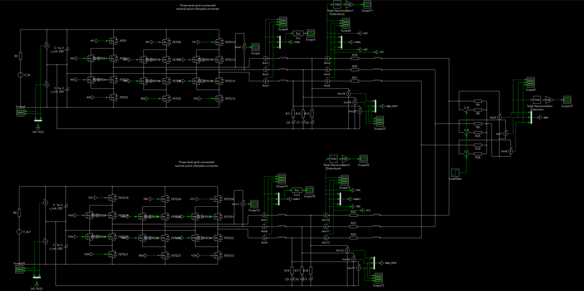
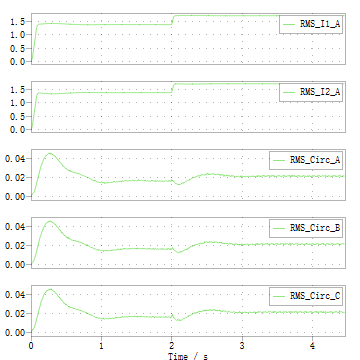

# 双ANPC并联下垂控制

这个模型在原单机ANPC控制器上加入两机并联、P–f和Q–V下垂、虚拟阻抗及负载阶跃，用于观察两机电流分配和环流。模型与[ANPC下垂 Word原稿](ANPC下垂.docx)由作者于2026年10月20日提供；Word按原文件收录。



## 准备与运行

沿用[运行步骤](getting-started.md)中的PLECS、TI C2000 TSP和自定义GPIO模块依赖，在仓库根目录执行：

```powershell
py scripts/prepare_project.py --model anpc_parallel_droop
```

然后打开生成的`build/anpc_parallel_droop.plecs`。两套控制器分别为`Controller`和`Controller1`；先在各自的`Control_logic`中选择`Codegen`分支，运行离线仿真。当前模型仿真时长为5 s，`LoadStep`在2 s时由0变为1。

模板位于`models/anpc_parallel_droop.plecs`，含本机路径占位符，不能直接运行。脚本填入两处模块目录、两处C头文件路径、两处代码生成目录和两处CCS项目路径。控制参数与电路连接均保留，来源与哈希见[文件清单](source-manifest.json)。

两个代码生成目录分别为`build/droop/controller1/codegen`和`build/droop/controller2/codegen`，避免构建文件混在一起。重新运行准备脚本不会默认覆盖已保存的模型编辑；`--force`只在确认可替换本机副本后使用。

原模型内部名称仍为`anpc_parallel_no_droop`，这是保存下来的名称；两套控制器中的`Droop_P`、`Droop_Q`和虚拟阻抗支路均已存在。

## 保存的主要参数

下列数值来自模型，两个控制器采用相同的下垂与虚拟阻抗参数。

| 参数或部件 | 数值 |
| --- | --- |
| 各机直流母线 | 400 V |
| 标称频率 `F0` | 50 Hz |
| PWM载波频率 | 80 kHz |
| 控制周期 | 50 µs |
| 高频PWM死区 | 200 ns |
| `Droop_P`增益 | `5e-5` Hz/W |
| 频率限幅 | 49至51 Hz |
| `Droop_Q`增益 | `0.005` V/var |
| d轴软启动参考上限 | 200 V，峰值量 |
| 下垂电压参考限幅 `VrefLimit` | 0至205 V |
| P、Q滤波器 | 分子`[0.003136663]`，分母`[1 -0.996863337]`，周期50 µs |
| 虚拟电阻 `VI_Rd`、`VI_Rq` | 3 Ω |
| 虚拟电感 `VI_Lv` | 0.01 H |
| 第一机线路 | 每相0.1 Ω与1 mH |
| 第二机线路 | 每相0.2 Ω与2 mH |
| 额外负载支路 | 每相200 Ω，由`S_A`、`S_B`、`S_C`控制 |

模型初始化中的死区注释仍写“1微秒”，实际赋值为`200e-9`。参数应按赋值核对。

## 结果与测量位置

Word原稿包含两机电感电流、输出电流、电压、有功与无功滤波值、下垂频率、THD，以及负载阶跃附近的局部波形。2 s前后的结果应在相同测点和窗口内比较。



此图提取自Word原稿。上两幅为`RMS_I1_A`、`RMS_I2_A`，下三幅为`RMS_Circ_A`、`RMS_Circ_B`、`RMS_Circ_C`。前者比较两机A相电流有效值，后者记录三相环流有效值。测量与计算支路保留在模型顶层，可结合两机P、Q和频率波形查看负载变化后的分配过程。

这些结果属于作者提供的仿真截图。本次入库核对了文件完整性、路径可迁移性和参数保留情况，未重新运行PLECS仿真；没有新增双DSP PIL或实际并联功率级验证记录。模型中两套控制器沿用相同的GPIO资源分配，不能据此认为一个F280049C已同时实现两台逆变器共36路门极输出。
